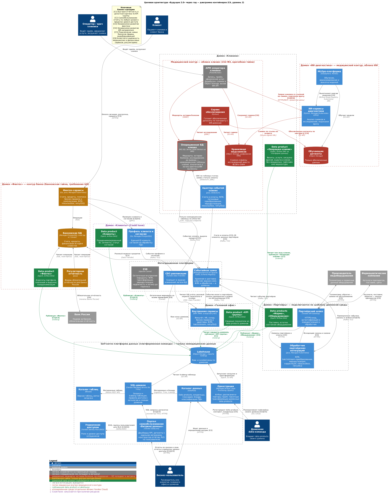

# Целевая архитектура «Будущее 2.0» через год

| Файл | Содержание |
|---|---|
| [c4_container.puml](c4_container.puml) | Исходник диаграммы контейнеров (C4-PlantUML) |
| [c4_container.png](c4_container.png) | Отрендеренная диаграмма |
| [problems.md](problems.md) | Проблемные места AS-IS, затронутые бизнес-сценарии и приоритизация (MoSCoW, матрица Эйзенхауэра) |

## Диаграмма контейнеров

На диаграмме связи подписаны кодами бизнес-сценариев, которые они обеспечивают:

| Код | Бизнес-сценарий | Цель бизнеса |
|---|---|---|
| С1 | Быстрая отчётность и целостная картина по KPI группы | Скорость управленческих решений, выручка |
| С2 | Самообслуживание: отчёты по любым срезам в пределах уровня доступа, конструктор собственных отчётов | Портал самообслуживания (цель года) |
| С3 | Независимое развитие финтеха | TTM финтех-продуктов, выручка банка |
| С4 | Независимое развитие ИИ-направления | TTM ИИ-продуктов, качество диагностики |
| С5 | Подключение новых бизнесов (фарма, производитель медоборудования) без доработки DWH | Масштабирование экосистемы, выручка |
| С6 | Качество и надёжность медицинских и финансовых сервисов, соответствие регуляторике | Качество сервисов, 152-ФЗ, банковская тайна |

## Ключевые архитектурные решения

1. **Data Mesh как модель владения, Lakehouse как технология.** Данные принадлежат доменам: «Клиники», «ИИ-диагностика», «Финтех», «Клиенты», «Головной офис», «Партнёры». Каждый домен сам публикует data products в общий Lakehouse (Object Storage + Apache Iceberg). Центральная команда DWH перестаёт быть бутылочным горлышком: платформенная команда отвечает за инструменты, а не за бизнес-логику доменов.
2. **Бизнес-логика уходит из DWH.**
   - Логика финтеха переезжает в контур банка.
   - Логика ИИ переезжает в ИИ-домен.
   - Расчёт KPI группы становится отдельным data product головного офиса и собирается из продуктов доменов.

   Новое направление подключается как новый домен со своими data products, центральное хранилище при этом не меняется.
3. **Портал самообслуживания на DataLens поверх Trino.** Портал строится на Yandex DataLens, запросы к Lakehouse выполняет Yandex Managed Service for Trino:
   - DataLens даёт дашборды, конструктор отчётов и датасеты с едиными определениями метрик, а также ограничивает строки по пользователю (RLS);
   - Trino выполняет SQL-запросы к Iceberg-таблицам через каталог Nessie. Правила доступа Trino разрешают подключению каждого домена только его схемы и опубликованные data products;
   - DataLens подключается к Trino штатным коннектором. Trino и DataLens — управляемые сервисы на открытом ядре, поэтому лицензионных рисков, как у Power BI, у них нет;
   - уровни доступа берутся из групп Yandex Identity Hub;
   - каталог DataHub помогает найти нужный data product и понять, как считается показатель.
4. **Изолированные контуры.** Медицинские и банковские данные лежат в отдельных облаках Yandex Cloud. Каждое облако со своей сетью, ключами KMS и правами доступа.
5. **Поэтапный перенос функций ESB в домены и платформу.** Домены обмениваются событиями через Managed Kafka с контрактами в Schema Registry. ФЛК, трансформации, маршрутизация, надёжность и логика старых маршрутов получают явных владельцев и целевые компоненты, описанные ниже. Данные из легаси забирает CDC (Yandex Data Transfer). ESB сохраняет полный набор функций ещё не перенесённых внутренних маршрутов до проверки их замены.
6. **Переносимые технологии.** Iceberg, Kafka, Kubernetes, PostgreSQL и S3-совместимое хранилище не привязывают компанию к одному провайдеру. Это снижает риск vendor lock-in при переезде в облако.

## Переход от ESB к целевым компонентам

ESB на Apache Camel рассматривается как исполняемый слой обработки: транспорт, форматно-логический контроль (ФЛК), пакетные и потоковые трансформации, маршрутизация, паттерны надёжности, интеграционная и бизнес-логика. Kafka отвечает за хранение и доставку событий; перенос транспорта сам по себе не заменяет остальные функции ESB. Точный состав правил фиксируется при инвентаризации маршрутов в первые два месяца.

| Функция ESB | Куда переходит и как исполняется | Владелец и бизнес-эффект |
|---|---|---|
| ФЛК | Адаптер событий клиник, обработчик партнёрских интеграций и обработчики в доменных сервисах проверяют обязательные поля, типы, диапазоны и связи полей. Schema Registry хранит версии схем и правила совместимости; проверку сообщений выполняют producer/consumer. Правила предметной области (например, допустимость оплаты счёта) проверяет сервис домена. Невалидные сообщения изолируются в карантине с причиной | Доменные команды задают правила, платформа — общий формат ошибок. С3, С5, С6: ошибочные данные не запускают операции и не попадают в опубликованные продукты |
| Пакетные трансформации | Доменные data products на Spark выполняют очистку, нормализацию, объединение и агрегирование данных; Airflow управляет расписанием, зависимостями и повторными запусками. Операционные пакетные обмены остаются в заданиях доменных адаптеров, без зависимости от аналитического Lakehouse | Data-команды и команды сервисов соответствующих доменов. С1, С5: отчётность ускоряется, новый бизнес не требует доработки DWH |
| Потоковые трансформации | Долгоживущие обработчики Kafka в адаптере клиник, обработчике партнёров и доменных сервисах преобразуют сообщения, обогащают их разрешёнными справочниками и публикуют события целевого контракта. Исполняются в среде своего домена, отдельно от пакетных DAG | Доменные команды. С3, С5: изменения форматов и оперативная обработка развиваются независимо |
| Маршрутизация | Партнёрский API Gateway направляет HTTPS-запросы в обработчик партнёров. Доменные адаптеры выбирают получателя по содержимому и публикуют события в согласованные Kafka topics; consumer groups определяют подписчиков. Синхронные вызовы идут в API доменов | Доменные команды поддерживают правила, платформа — topics и ACL. С4, С5: новые получатели подключаются без общего релиза ESB |
| Паттерны надёжности | В сервисах и адаптерах: transactional outbox при публикации события вместе с изменением БД, дедупликация по event ID / inbox у потребителя, ограниченные retry с backoff, DLQ и управляемый replay. Для синхронных вызовов — timeout и circuit breaker; для пакетов — контрольные точки и идемпотентная загрузка | Платформа предоставляет шаблоны и мониторинг lag, ошибок и DLQ; домен отвечает за восстановление своего потока. С3, С6: повторная доставка не создаёт повторную оплату, сбои не теряют операции |
| Интеграционная логика | Протокольные адаптеры, преобразование внешних идентификаторов, split/aggregate, корреляция запросов и ответов — в адаптере клиник, обработчике партнёров и адаптерах внутренних сервисов. Их контракты версионируются вместе с доменными сервисами | Команда домена-получателя, для партнёров — команда партнёрских интеграций. С5: особенности внешней системы не распространяются на все домены |
| Бизнес-логика | Правила платежей, кредитов и компенсаций — в финтех-сервисах; медицинские правила — в контуре клиник; диагностическая логика — в ИИ-сервисах; правила учёта — во внутренних сервисах. Междоменный процесс координирует сервис домена-инициатора с явным состоянием и компенсациями. Аналитические расчёты — в data products | Команды соответствующих доменов. С3, С4, С6: независимые релизы и сохранение смысла операций при миграции |

Медицинские payload, включая карантин, DLQ, журналы и пакетные промежуточные данные, остаются в медицинском контуре; банковские данные — в контуре банка. В общую Kafka публикуются только разрешённые контрактами события. Перенос функций ESB не открывает новый поток медданных в платформу аналитики.

### Порядок переключения маршрутов

1. **0–2 месяца: инвентаризация.** Платформенная и доменные команды составляют реестр маршрутов Camel: источники и получатели, ФЛК, обе формы трансформаций, правила маршрутизации, обработка ошибок, интеграционная и бизнес-логика, класс данных, SLA, владелец и целевой компонент. Правила фиксируются примерами входов и ожидаемых результатов, включая ошибки и повторы. Новая бизнес-логика в центральную ESB и DWH не добавляется.
2. **2–12 месяцев: перенос по потокам.** Сначала реализуются целевые правила и механизмы надёжности, затем поток проверяется на контрактных и регрессионных сценариях. В теневом режиме сравниваются результаты старого и нового пути без повторных бизнес-операций. Перед переключением проверяются сбой получателя, повторная доставка, восстановление из DLQ и сверка количества сообщений, сумм и итоговых статусов.
3. **Переключение и откат.** Для каждого потока задаются окно наблюдения и допустимые расхождения по SLA. Запись бизнес-результата выполняет только один активный путь; фиксируются граница переключения, обработанные event ID и остаток очередей. При нарушении критериев новый путь останавливается, результаты сверяются, старый маршрут возобновляется с учётом уже выполненных операций. Это исключает слепую повторную отправку платежей при откате.
4. **Через год: ограниченный Retain.** Критичные потоки финтеха и ИИ и новые партнёрские подключения работают на целевых компонентах. В Camel остаются только ещё не перенесённые внутренние маршруты вместе с их ФЛК, трансформациями, логикой и обработкой ошибок. Для каждого остаточного маршрута назначены владелец и срок вывода. Маршрут отключается после приёмки доменом-получателем, сверки результатов, завершения окна наблюдения и обработки накопленных сообщений.

## Медицинские данные не попадают в витрину

Медкарты, истории болезни и результаты исследований (включая снимки) не попадают в витрину. Это обеспечивают четыре независимых барьера:

| Барьер | Как работает |
|---|---|
| Отдельные облака медицинского контура | Медицинский контур состоит из двух облаков: облака клиник и облака ИИ, связанных приватным каналом. Операционная БД клиник, хранилище снимков и обучающие датасеты физически не находятся в платформе данных. Из платформы в контур есть только один путь: CDC-трансфер через выделенный read-only endpoint |
| Allow-list в CDC | Data Transfer реплицирует из операционной БД клиник только явно разрешённые немедицинские таблицы: пациенты, услуги, счета пациентов. ID пациента псевдонимизируется при репликации, поэтому в Lakehouse он не совпадает с номером медкарты |
| Data product «Операции клиник» | Домен публикует только операционные показатели: визиты, услуги, загрузку врачей, выручку. Диагнозы и результаты исследований в него не входят. Пациент представлен псевдонимизированным ID из raw-зоны, услуги укрупнены до групп, по которым нельзя восстановить диагноз. Пайплайн продукта принадлежит домену «Клиники», но исполняется на платформе данных и читает только raw-зону, которую наполнил CDC, поэтому второго пути в медконтур не появляется |
| Классификация и политики | DataHub помечает поля с персональными данными. Правила доступа Trino и RLS в DataLens закрывают их от ролей без допуска. Платформа отклоняет публикацию data product с полями, помеченными как медицинские |

ИИ-домен работает с медданными внутри медицинского контура по двум путям, и ни один из них не ведёт в витрину:

- **Инференс.** АРМ передаёт в запросе анализа временную ссылку на конкретный снимок (pre-signed URL), ИИ-сервис по приватной связи читает только этот снимок. Постоянного доступа к хранилищу клиник у ИИ-домена нет.
- **Обучение.** Модели обучаются только на обезличенных датасетах, которые готовит сервис обезличивания клиник по согласованному контракту.

## Как целевая архитектура поддерживает бизнес-сценарии

| Сценарий | Как обеспечивается | Ожидаемый эффект |
|---|---|---|
| С1. Быстрая отчётность | Аналитические запросы идут в Lakehouse через Trino и больше не нагружают операционную БД клиник. Данные хранятся в колоночном Parquet/Iceberg, Trino масштабируется горизонтально. Частые агрегаты заранее материализуются в curated-зоне. «KPI группы» — готовый data product, а не цепочка трансформаций в DWH | Типовые отчёты за минуты вместо часов, единые значения KPI во всех отчётах |
| С2. Самообслуживание | DataLens (датасеты с едиными метриками, RLS) + Trino + SSO и группы Identity Hub + каталог DataHub. Сотрудник видит только те data products и строки, которые разрешены его роли. Свои отчёты он собирает из готовых витрин | Отчёты по любым срезам без заявки в центральную команду. Портал масштабируется добавлением data products, а не доработкой хранилища |
| С3. Независимое развитие финтеха | У банка своё облако, свой Kubernetes и свои БД, команда сама публикует data product «Финтех». Другие домены получают события оплат и кредитов из Kafka по контракту | Релизы финтеха не ждут изменений DWH. Требования ЦБ выполняются внутри одного контура |
| С4. Независимое развитие ИИ | Своё облако, MLOps-платформа (DataSphere, MLflow), обезличенные датасеты по контракту с клиниками, отдельный API инференса | Обучение и выкатка моделей без участия команды DWH, быстрее вывод новых ИИ-сервисов |
| С5. Подключение новых бизнесов | Новый домен разворачивается из шаблона среды (IaC). Данные партнёров принимаются через API Gateway и Kafka по контракту, затем публикуются как data products и регистрируются в DataHub | Фарма и производитель оборудования подключаются без изменений DWH и платформы, отчёты по ним сразу доступны в портале |
| С6. Качество и регуляторика | Изоляция медицинского и банковского контуров, шифрование KMS. Банковские БД реплицируются в трёх зонах доступности. Снимки вынесены в объектное хранилище. Есть резервное копирование, единая точка отказа ESB снята с критичных потоков | Выше доступность критичных сервисов, проще аудит по 152-ФЗ и требованиям ЦБ |

## Контейнеры по доменам

| Домен / зона | Контейнеры | Ответственная команда |
|---|---|---|
| Клиники | В медконтуре: АРМ оператора (легаси), операционная БД клиник (легаси), хранилище медснимков, сервис обезличивания, адаптер событий клиник. Вне медконтура: data product «Операции клиник» (пайплайн на платформе данных) | Команда клиник |
| ИИ-диагностика (медконтур) | ИИ-сервисы диагностики, MLOps-платформа, обучающие датасеты | Команда ИИ |
| Финтех (контур банка) | Финтех-сервисы, банковские БД, регуляторная отчётность для Банка России, data product «Финтех» | Команда банка |
| Клиенты (Could have, П11) | Профиль клиента и согласия на обработку ПДн, data product «Клиенты» | Команда клиентского домена |
| Головной офис | Внутренние сервисы (финучёт, персонал, инвентаризация), data product «KPI группы» | Финансы и аналитика головного офиса |
| Партнёры | Партнёрский шлюз, обработчик партнёрских интеграций, data products «Фарма» и «Оборудование» | Команда партнёрских интеграций |
| Интеграционная платформа | Событийная шина Kafka, CDC-репликация, ESB (легаси) | Платформенная команда |
| Self-serve платформа данных | Портал «Витрина данных», SQL-движок Trino, Lakehouse, каталог таблиц, оркестрация, каталог данных, управление доступом | Платформенная команда, политики задаёт группа federated governance |

## Легаси через год

Бизнес допускает временное сохранение легаси в отдельных доменах. Через год оно остаётся только там, где замена не нужна для достижения целей года.

| Система | Решение через год | Обоснование |
|---|---|---|
| DWH на MS SQL Server 2008 | **Rehost** в медицинский контур как операционной БД клиник. В ней остаются медкарты, истории болезни, исследования и немедицинские таблицы клиник: пациенты, услуги, счета пациентов. Немедицинские таблицы реплицируются в Lakehouse через CDC. Остальные данные переезжают к доменам-владельцам: кредиты и финансовая история — в банковские БД (разовая миграция Data Transfer), персонал и инвентаризация — во внутренние сервисы. Аналитика и логика финтеха и ИИ из БД вынесены. Вывод СУБД — отдельным проектом после года | В БД лежат медкарты и истории болезни, их перенос — самый рискованный шаг. Версия СУБД при переносе не обновляется по двум причинам: новые лицензии Microsoft в РФ труднодоступны, а АРМ на PowerBuilder привязан к текущей схеме и драйверам. Риск неподдерживаемой версии закрывается компенсирующими мерами: БД без внешнего доступа, единственный внешний путь — read-only CDC, резервное копирование. Целевая замена — PostgreSQL вместе с заменой АРМ |
| АРМ на PowerBuilder | **Retain** на переходный период с минимальной доработкой: снимки сохраняются в объектное хранилище, анализ исследования запрашивается у ИИ-сервиса по REST вместо обмена через ESB | Операционная работа клиник не должна остановиться. Полная замена АРМ не влияет на цели года, а точечная доработка снимает нагрузку снимков с СУБД и зависимость ИИ от шины |
| Power BI | **Retire** после переноса используемых отчётов в портал | Портал заменяет BI. Кастомизации поверх DWH не переносятся 1:1 |
| ESB (Apache Camel) | **Refactor** функций по таблице перехода выше; **Retain** остаточных внутренних маршрутов со всеми их правилами до приёмки замены. Новые потоки — через API, доменные обработчики и Kafka | Поэтапное переключение сохраняет ФЛК, трансформации, маршрутизацию, надёжность и бизнес-поведение; вывод транспорта не опережает перенос логики |
| ИИ-сервисы (Python) | **Replatform** на Managed Kubernetes и MLOps-платформу | Независимый цикл обучения и выкатки моделей |
| Финтех-сервисы (Go, Java) | **Rehost / Replatform** в отдельное облако банка | Требования ЦБ и банковская тайна, независимые релизы |
