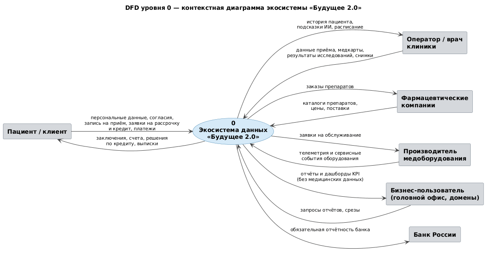
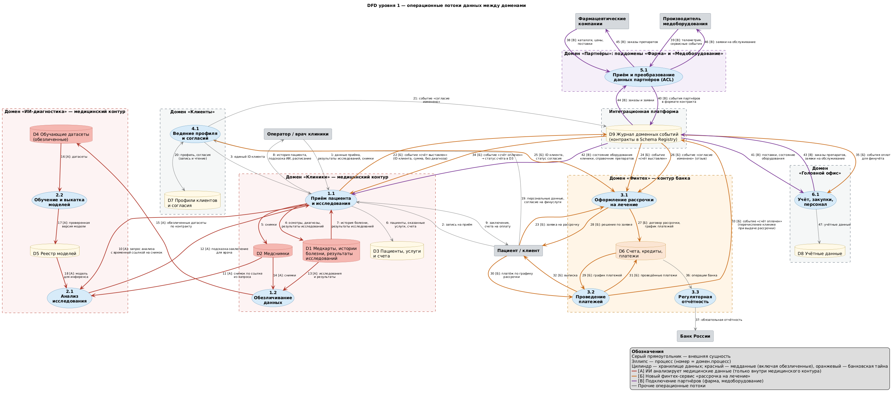
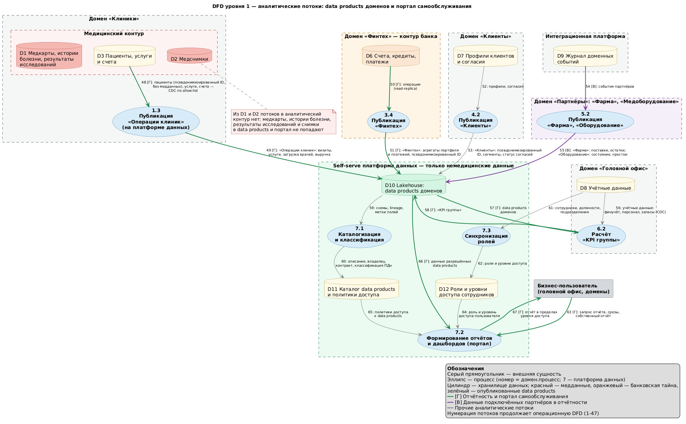

# Домены и потоки данных «Будущее 2.0»

| Файл | Содержание |
|---|---|
| [dfd_level0.puml](dfd_level0.puml), [dfd_level0.png](dfd_level0.png) | DFD уровня 0 — контекстная диаграмма |
| [dfd_operational.puml](dfd_operational.puml), [dfd_operational.png](dfd_operational.png) | DFD уровня 1 — операционные потоки между доменами (потоки 1–47) |
| [dfd_analytical.puml](dfd_analytical.puml), [dfd_analytical.png](dfd_analytical.png) | DFD уровня 1 — аналитические потоки: data products и портал самообслуживания (потоки 48–67) |

Домены совпадают с доменами [целевой архитектуры](../Task1/README.md).

## 1. Домены

| Домен | Тип (DDD) | Подразделение-владелец | Бизнес-возможности | Данные домена | Публикуемые data products | Регуляторный режим |
|---|---|---|---|---|---|---|
| **Клиники** | Core | Клиники | Запись и приём пациентов, исследования, оказание услуг, счета пациентов | Медкарты, истории болезни, результаты исследований, снимки; пациенты, услуги и счета | «Операции клиник»: визиты, услуги, загрузка врачей, выручка — без медданных | 152-ФЗ (специальная категория ПДн), врачебная тайна |
| **ИИ-диагностика** | Core | Компания ИИ-сервисов | Анализ исследований, подсказки врачу, обучение и выкатка моделей | Обезличенные обучающие датасеты, реестр моделей | — (результаты анализа возвращаются только в клиники) | Медицинский контур; обучение только на обезличенных данных |
| **Финтех** | Core | Финтех-компания с банковской лицензией | Счета, кредиты, платежи, рассрочка на лечение, регуляторная отчётность | Счета, кредиты, платежи, финансовая история | «Финтех»: агрегаты портфеля и платежей с псевдонимизированным ID клиента | Банковская тайна, требования Банка России |
| **Клиенты** | Supporting | Головной офис | Единый профиль клиента, согласия на обработку ПДн | Профили и согласия | «Клиенты»: псевдонимизированный ID, сегменты, статус согласий | 152-ФЗ |
| **Партнёры**: поддомены «Фарма» и «Медоборудование» | Supporting | Команда партнёрских интеграций | Приём и преобразование данных партнёров, передача заказов и заявок | Каталоги, поставки, телеметрия оборудования | «Фарма», «Оборудование» | Договоры с партнёрами, коммерческая тайна |
| **Головной офис** | Supporting (учётные системы ERP/HRM — Generic) | Головной офис | Финучёт и отчётность, персонал, закупки, инвентаризация, сводные KPI | Учётные данные | «KPI группы» — сводные показатели из data products доменов | Бухгалтерский и налоговый учёт, ПДн сотрудников |

Платформенные зоны не являются бизнес-доменами:

- **Интеграционная платформа** — журнал доменных событий (Kafka) и CDC.
- **Self-serve платформа данных** — Lakehouse, каталог, портал самообслуживания.

Обе зоны принадлежат платформенной команде. Она не владеет бизнес-логикой: только инструментами, по которым домены сами публикуют и потребляют данные. Стандарты (формат контрактов, классификация данных, правила доступа) задаёт группа federated governance из представителей доменов, ИБ и платформы. Платформа применяет их автоматически.

## 2. Логика разделения на домены

Границы проведены по пяти признакам. Каждый из них отвечает на вопрос, почему направление может развиваться отдельно.

| Признак | Почему он важен для бизнеса | Как он повлиял на границы |
|---|---|---|
| Бизнес-возможность и язык предметной области | Слово «клиент» для клиники означает пациента, для банка — заёмщика. Общая модель в DWH заставляет согласовывать каждое изменение со всеми | Клиники, Финтех и Головной офис — отдельные bounded contexts. Общий только идентификатор клиента, он вынесен в домен «Клиенты» |
| Организационная структура | В компании четыре подразделения, ИИ и финтех — отдельные компании. Границы доменов совпадают с границами команд, поэтому у каждого домена один владелец | Клиники, ИИ-диагностика, Финтех и Головной офис соответствуют подразделениям |
| Регуляторный режим | Медданные, банковская тайна и обычные ПДн требуют разных мер защиты. В одном контуре приходится применять самые жёсткие меры ко всему | Медицинский контур (Клиники + ИИ) и контур банка изолированы. Аналитика работает только с немедицинскими data products |
| Скорость изменений | Финтех выпускает продукты часто, ИИ обновляет модели по своему циклу, учёт меняется редко. Общий релизный цикл тормозит самых быстрых | ИИ отделён от Клиник: модели выкатываются без релиза клинических систем. Финтех отделён от учёта |
| Источник и владелец данных | Качество данных обеспечивает тот, кто их создаёт. Центральная команда DWH не может знать все направления | Каждый домен публикует свои data products сам. KPI группы строятся из готовых продуктов доменов, а не из сырых таблиц |

### Почему границы проведены именно так

- **Клиники и ИИ-диагностика — разные домены в одном медицинском контуре.** ИИ работает с медданными, поэтому остаётся в контуре 152-ФЗ. При этом у него своя команда, свой цикл обучения и свои метрики качества. Связь между доменами — два контракта:
  - API анализа исследования (потоки 10–12). Клиники передают в запросе временную ссылку на снимок (pre-signed URL), ИИ читает по ней только этот снимок (поток 11). Постоянного доступа к хранилищу клиник у ИИ-домена нет;
  - обезличенные датасеты для обучения (потоки 13–16).

  Новая модель выходит без изменений в клинических системах и в DWH.
- **Финтех — отдельный домен в отдельном контуре.** Банковская лицензия требует изоляции и собственной регуляторной отчётности (потоки 36–37). Клиники и финтех обмениваются только событиями «счёт выставлен» и «счёт оплачен». Диагнозов в этих событиях нет, банковских данных тоже.
- **Клиенты — отдельный supporting-домен.** Если профиль клиента принадлежит клиникам, банк зависит от их релизов, и наоборот. Отдельный домен даёт клиникам и банку единый ID клиента (потоки 3, 25), а также единый реестр согласий. По 152-ФЗ согласие нужно для передачи данных пациента в финансовые сервисы.
- **Партнёры — домен, который подключается по шаблону.** Фармацевтические компании и производитель оборудования — внешние организации со своими форматами. «Фарма» и «Медоборудование» — два поддомена, развёрнутых из одного шаблона доменной среды. Процесс 5.1 работает как Anticorruption Layer: переводит данные партнёров в контракты экосистемы.

  Данные партнёров нужны двум доменам:
  - клиникам — справочник препаратов для назначений и состояние оборудования, установленного в клинике (поток 42);
  - головному офису — для закупок и сервиса (потоки 41, 43).

  Следующий партнёр подключается как ещё один поддомен из того же шаблона. Изменения в других доменах и в DWH не нужны.
- **Головной офис потребляет data products, а не таблицы DWH.** Сводные KPI считаются в data product «KPI группы» (процесс 6.2) из опубликованных продуктов доменов. Целостная картина сохраняется, а бизнес-логика расчёта находится у владельца — финансов головного офиса.
- **Бывший DWH остаётся внутри домена «Клиники».** На переходный период D1 и D3 физически находятся в легаси-БД клиник (MS SQL Server), а D2 — в объектном хранилище медицинского контура. Аналитика читает из легаси-БД только немедицинские таблицы D3 через CDC по allow-list (поток 48). Бизнес-логика финтеха, ИИ и отчётности из неё вынесена.
- **Как легаси-БД клиник участвует в обмене событиями.** АРМ на PowerBuilder не умеет публиковать события. Поэтому обмен с журналом событий выполняет адаптер событий клиник. Он забирает новые счета из таблицы счетов через CDC (Debezium) и публикует «счёт выставлен» (поток 22). Обратно он принимает «счёт оплачен» и записывает статус оплаты в легаси-БД (поток 34). На DFD адаптер входит в процесс 1.1.

## 3. Связи между доменами (карта контекстов)

| Поставщик → потребитель | Тип связи (DDD) | Что передаётся | Потоки |
|---|---|---|---|
| ИИ-диагностика → Клиники | Customer–Supplier: Клиники — заказчик API анализа | Запрос анализа с временной ссылкой на снимок, подсказка-заключение для врача | 10–12 |
| Клиники → ИИ-диагностика | Customer–Supplier + Published Language: контракт на обезличенный датасет | Обезличенные датасеты для обучения | 13–16 |
| Клиенты → Клиники, Финтех | Open Host Service | Единый ID клиента, статус согласий, события изменения согласий | 3, 21, 25, 26 |
| Клиники ↔ Финтех | Published Language: события в журнале по контракту | «Счёт выставлен», «счёт оплачен» | 22, 24, 33, 34 |
| Финтех → Головной офис | Published Language | События оплат для финучёта | 35 |
| Партнёры → Клиники, Головной офис | Anticorruption Layer на стороне домена «Партнёры» | Справочник препаратов, состояние оборудования, поставки; обратно — заказы и заявки | 38–46 |
| Все домены → Головной офис («KPI группы») | Conformist: KPI строятся по контрактам опубликованных data products | Data products доменов | 57–58 |
| Легаси-БД клиник → платформа данных | Anticorruption Layer: CDC по allow-list | Только немедицинские таблицы, ID пациента псевдонимизируется при репликации | 48 |

## 4. Диаграммы потоков данных

Нотация основана на Йордоне — Де Марко и адаптирована под PlantUML:

- прямоугольник — внешняя сущность;
- эллипс — процесс (номер «домен.процесс»);
- цилиндр — хранилище данных;
- стрелка — поток с номером и составом данных.

Пунктирные рамки — границы доменов. Красная рамка — медицинский контур, оранжевая — контур банка. Хранилища и внешние сущности связаны только через процессы.

### Уровень 0 — контекст

Экосистема обменивается данными с шестью внешними сущностями. Бизнес-пользователь получает отчёты без медицинских данных. Банк России получает только обязательную отчётность банка. На уровне 1 каждый поток уровня 0 раскрывается так:

| Поток уровня 0 | Потоки уровня 1 |
|---|---|
| Пациент → экосистема: персональные данные, согласия, запись, заявки, платежи | 2, 19, 23, 30 |
| Экосистема → пациент: заключения, счета, решения по кредиту, выписки | 9, 28, 32 |
| Оператор ↔ экосистема | 1, 8 |
| Фарма ↔ экосистема | 38, 45 |
| Производитель медоборудования ↔ экосистема | 39, 46 |
| Бизнес-пользователь ↔ экосистема | 63, 67 |
| Экосистема → Банк России | 37 |

### Уровень 1 — операционные потоки

### Уровень 1 — аналитические потоки

### Хранилища данных

| Хранилище | Домен | Класс данных | Попадает в аналитику |
|---|---|---|---|
| D1 Медкарты, истории болезни, результаты исследований | Клиники | Медданные | Нет |
| D2 Медснимки | Клиники | Медданные | Нет |
| D3 Пациенты, услуги и счета | Клиники | ПДн, финансовые | Да, через data product «Операции клиник» |
| D4 Обучающие датасеты | ИИ-диагностика | Обезличенные медданные | Нет |
| D5 Реестр моделей | ИИ-диагностика | Модели | Нет |
| D6 Счета, кредиты, платежи | Финтех | Банковская тайна | Только агрегаты с псевдонимизированным ID |
| D7 Профили клиентов и согласия | Клиенты | ПДн | Только псевдонимизированный ID и сегменты |
| D8 Учётные данные | Головной офис | ПДн сотрудников, финансовые | Да, через «KPI группы» |
| D9 Журнал доменных событий | Интеграционная платформа | События по контрактам, без медданных | Через data products партнёров |
| D10 Lakehouse: data products | Платформа данных | Немедицинские, псевдонимизированные | — |
| D11 Каталог и политики доступа | Платформа данных | Метаданные | — |
| D12 Роли и уровни доступа | Платформа данных | Учётные записи сотрудников | — |

## 5. Как бизнес-сценарии обеспечены потоками данных

### [А] Использование ИИ для анализа медицинских данных

| Шаг | Потоки | Что происходит |
|---|---|---|
| Анализ на приёме | 10 → 11 → 12 → 8 | Врач запрашивает анализ, в запросе — временная ссылка на снимок. ИИ-сервис читает по ней только этот снимок и возвращает подсказку. Она попадает к врачу вместе с историей пациента |
| Подготовка обучения | 13, 14 → 15 | Сервис обезличивания клиник готовит датасет по контракту и передаёт его в ИИ-домен |
| Новая версия модели | 16 → 17 → 18 | ИИ-домен обучает модель, регистрирует проверенную версию и выкатывает её в инференс |

Все потоки сценария проходят внутри медицинского контура. В журнал событий и в аналитический контур медданные не попадают. DWH в сценарии не участвует.

### [Б] Интеграция нового финтех-сервиса «рассрочка на лечение»

| Шаг | Потоки | Что происходит |
|---|---|---|
| Согласие клиента | 19 → 20 → 21 | Клиент даёт согласие на финансовые услуги, домен «Клиенты» фиксирует его и публикует событие |
| Счёт за лечение | 22 → 24 | Клиники публикуют событие «счёт выставлен»: ID клиента и сумма, без диагноза |
| Оформление | 23 → 25 → 27 → 28 | Банк принимает заявку, проверяет ID и согласие, заключает договор и сообщает решение. При отзыве согласия банк получает событие (поток 26) |
| Оплата | 33; 29, 30 → 31 → 32 | При выдаче рассрочки банк перечисляет клинике сумму счёта и публикует «счёт оплачен». Дальше пациент гасит рассрочку по графику, банк проводит платежи и выдаёт выписки |
| Учёт оплаты | 34, 35 | Клиники обновляют статус счёта, головной офис отражает оплату в учёте |
| Аналитика | 50 → 51 | Финтех публикует обновлённый data product, новые показатели сразу доступны в портале |

Чтобы запустить сервис, финтех-команда подписывается на уже существующее событие клиник и публикует свои события. Доработки DWH и других доменов не нужны.

Домен «Клиенты» в приоритизации отнесён к категории Could have (П11 в [problems.md](../Task1/problems.md)). Пока он не запущен, финтех берёт согласие на финансовые услуги из собственного реестра (вместо потоков 19–21, 25). Клиента из события «счёт выставлен» банк сопоставляет по ID пациента клиники и данным заявки. Поток 3 к клиникам появляется вместе с доменом. Остальные потоки сценария не меняются.

### [В] Подключение нового партнёра (фарма, производитель медоборудования)

| Шаг | Потоки | Что происходит |
|---|---|---|
| Приём данных | 38, 39 → 40 | Партнёр передаёт данные в своём формате. Процесс 5.1 переводит их в контракт экосистемы и публикует события |
| Использование в клиниках | 42 | Клиники получают справочник препаратов для назначений и состояние своего оборудования |
| Закупки и сервис | 41 → 43 → 44 → 45, 46 | Головной офис получает поставки и состояние оборудования, отправляет заказы и заявки на обслуживание |
| Аналитика | 54 → 55 | Data products «Фарма» и «Оборудование» становятся доступны в портале |

Следующий партнёр подключается как новый поддомен из того же шаблона: шлюз, преобразование, data product, регистрация в каталоге.

### [Г] Отчётность и портал самообслуживания

| Шаг | Потоки | Что происходит |
|---|---|---|
| Публикация | 48 → 49, 50 → 51, 52 → 53, 54 → 55 | Каждый домен сам публикует свои data products. Контракт data product проверяется при регистрации: схема сверяется с классификацией полей, и продукт с полями, помеченными как медицинские, не публикуется |
| Сводные показатели | 56, 57 → 58 | Головной офис строит «KPI группы» из продуктов доменов и учётных данных |
| Каталог | 59 → 60 | Платформа собирает схемы и lineage, ведёт описание, владельцев и классификацию ПДн |
| Роли | 61 → 62 | Роли и уровни доступа синхронизируются со штатной структурой |
| Отчёт | 63 → 64, 65, 66 → 67 | Пользователь запрашивает отчёт. Портал учитывает его роль и политики доступа и отдаёт данные только разрешённых data products |

## 6. Преимущества разделения для бизнеса

| Преимущество | Сейчас | После разделения на домены |
|---|---|---|
| **Ускорение вывода продуктов** | Новый продукт финтеха или ИИ требует изменения логики и схемы DWH и встаёт в очередь центральной команды | Домен меняет свои сервисы и публикует события или data product по контракту. Рассрочка на лечение запускается без доработки чужих систем (сценарий Б), новая модель ИИ — без релиза клиник (сценарий А) |
| **Снижение зависимости от DWH** | DWH — центральная точка всех потоков: операционных, интеграционных и аналитических. Его отказ или перегрузка останавливает всё | Легаси-БД остаётся только операционным хранилищем клиник. Интеграции идут через журнал событий, аналитика — через data products. Отчёты больше не нагружают БД, с которой работают операторы |
| **Отдельное развитие направлений** | Изменения одного направления ломают отчёты и интеграции другого. Требования банка и медицины применяются ко всему хранилищу | У каждого домена свой владелец, свой контур и свой релизный цикл. Совместимость обеспечивают контракты, а не общая схема |
| **Подключение новых бизнесов** | Фарма и производитель оборудования потребовали бы новых таблиц, трансформаций и отчётов в DWH | Партнёр подключается по шаблону домена (сценарий В) и сразу появляется в портале |
| **Скорость и качество отчётности** | Отчёты строятся часами на общей СУБД, показатели в разных отчётах расходятся | Отчёты строятся по готовым data products с едиными определениями метрик. У каждой метрики есть владелец, видны её источник и lineage |
| **Соответствие регуляторике** | Медданные, банковская тайна и ПДн лежат в одном хранилище, доступ выдаётся целиком | Медданные не покидают медицинский контур, банковские данные — контур банка. В аналитику попадают только агрегаты и псевдонимизированные данные |
