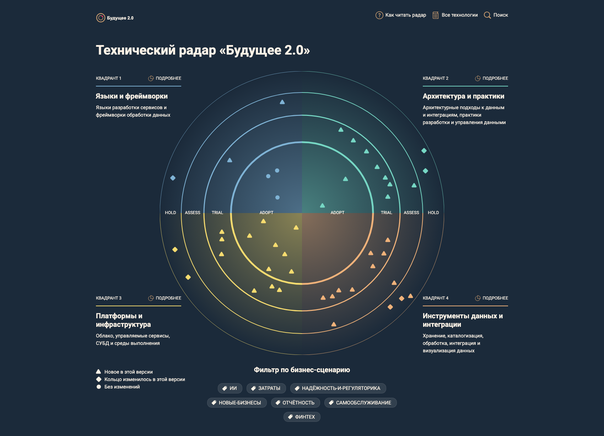
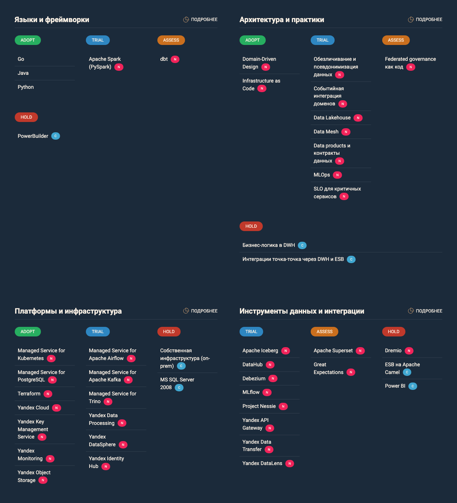

# Технический радар и роадмап «Будущее 2.0»

| Файл | Содержание |
|---|---|
| [tech_radar.png](tech_radar.png) | Технический радар: распределение технологий по квадрантам и кольцам |
| [tech_radar_list.png](tech_radar_list.png) | Технологии радара списком по квадрантам и кольцам |
| [techradar/](techradar/) | Исходники радара (AOE Technology Radar): [config.json](techradar/config.json), элементы в [radar/](techradar/radar/), страница [about.md](techradar/about.md) |
| [roadmap.md](roadmap.md) | Роадмап: этапы, ожидаемые результаты, команды, ресурсы, обоснование каждого этапа |
| [roadmap.puml](roadmap.puml), [roadmap.png](roadmap.png) | Диаграмма Ганта роадмапа |

## Технический радар





Радар ведётся как код в формате [AOE Technology Radar](https://github.com/AOEpeople/aoe_technology_radar). Сборка и просмотр:

```bash
cd techradar
npm install
npm run serve   # http://localhost:3000
npm run build   # статический сайт в techradar/build
```

### Устройство радара

**Квадранты** адаптированы под компанию, которая работает с данными:

- языки и фреймворки;
- архитектура и практики;
- платформы и инфраструктура;
- инструменты данных и интеграции.

**Кольца:**

- **Adopt** — используем и рекомендуем;
- **Trial** — пилотируем на задачах доменов;
- **Assess** — изучаем;
- **Hold** — не используем в новых проектах и выводим.

**Две версии.** Радар состоит из двух версий:

- **2026-09-01** — инвентаризация текущего стека;
- **2026-10-01** — целевой радар.

Метки «Новое» и «Изменено» показывают разницу между версиями. Перевод MS SQL Server 2008, Power BI, PowerBuilder, ESB и практики «бизнес-логика в DWH» в Hold виден на радаре как изменение кольца.

**Теги** — бизнес-сценарии. Коды сценариев совпадают с [целевой архитектурой](../Task1/README.md):

| Код | Тег на радаре | Бизнес-сценарий |
|---|---|---|
| С1 | `отчётность` | Быстрая отчётность и целостная картина по KPI |
| С2 | `самообслуживание` | Самообслуживание в пределах уровня доступа |
| С3 | `финтех` | Независимое развитие финтеха |
| С4 | `ИИ` | Независимое развитие ИИ |
| С5 | `новые-бизнесы` | Подключение новых бизнесов |
| С6 | `надёжность-и-регуляторика` | Надёжность и регуляторика |
| — | `затраты` | Технологии, которые снижают затраты |

В карточке каждой технологии на радаре описаны решение, поддерживаемые бизнес-сценарии и причина выбора кольца.

**Критерий выбора кольца.** Adopt — стандарт с первого этапа. Сюда попадают зрелые технологии в managed-варианте, где эксплуатацию берёт провайдер: Kubernetes, PostgreSQL, Object Storage, KMS. Сюда же попадают практики, без которых нельзя начать: DDD, IaC и Terraform (короткий путь по кольцам). Trial — технологии и практики, которые для компании новые и требуют проверки на задачах доменов: платформа данных, событийная интеграция, Data Mesh. Kafka как технология зрелая, но в Trial её держит новая для компании практика событийной интеграции. В Adopt они переходят только после пилотов роадмапа.

## Технологии и бизнес-сценарии

В колонке «Сценарии» — коды бизнес-сценариев. Полное обоснование и причина выбора кольца — в карточке технологии на радаре.

### Adopt (12)

| Технология | Квадрант | Изменение | Сценарии | Решение |
|---|---|---|---|---|
| Go | Языки и фреймворки | без изменений | С3, С6 | Язык финтех-сервисов и сервиса профиля клиента. |
| Java | Языки и фреймворки | без изменений | С3, С6 | Язык финтех-сервисов и адаптера событий клиник. |
| Python | Языки и фреймворки | без изменений | С1, С4 | Основной язык ИИ-сервисов, MLOps-конвейеров и пайплайнов data products. |
| Domain-Driven Design | Архитектура и практики | новое | С3, С4, С5 | Стратегический DDD — основа границ доменов и data products: bounded contexts, карта контекстов, Anticorruption Layer для легаси и партнёров. |
| Infrastructure as Code | Архитектура и практики | новое | С5, С6, затраты | Вся облачная инфраструктура описывается кодом (Terraform). Шаблон доменной среды — модуль, из которого разворачивается новый домен или партнёр. |
| Managed Service for Kubernetes | Платформы и инфраструктура | новое | С3, С4, С6 | Среда выполнения финтех-сервисов, ИИ-инференса (GPU-узлы) и сервисов доменов. |
| Managed Service for PostgreSQL | Платформы и инфраструктура | новое | С3, С6 | Операционные БД банка, профиля клиента и новых сервисов. Целевая СУБД для замены MS SQL Server. |
| Terraform | Платформы и инфраструктура | новое | С5, С6, затраты | Инструмент IaC для всех облачных сред: сети, NAT, ВМ, кластеры, бакеты, IAM. |
| Yandex Cloud | Платформы и инфраструктура | новое | С5, С6, затраты | Основное облако. Отдельные облака для медицинского контура (клиники, ИИ), контура банка и платформы данных. |
| Yandex Key Management Service | Платформы и инфраструктура | новое | С3, С4, С6 | Шифрование медснимков, обучающих датасетов, банковских БД и бакетов Lakehouse ключами, которыми управляет компания. Отдельные ключи для медицинского контура и контура банка. |
| Yandex Monitoring | Платформы и инфраструктура | новое | С3, С6 | Метрики, дашборды и алерты облачных сервисов и приложений доменов. Источник данных для SLO записи пациентов и платежей и для контроля свежести data products. |
| Yandex Object Storage | Платформы и инфраструктура | новое | С1, С4, затраты | Хранилище Lakehouse, медснимков (в медконтуре) и обучающих датасетов. S3-совместимый API. |

### Trial (22)

| Технология | Квадрант | Изменение | Сценарии | Решение |
|---|---|---|---|---|
| Apache Spark (PySpark) | Языки и фреймворки | новое | С1, С5 | Фреймворк загрузки и трансформации данных при публикации data products. Запускается в Yandex Data Processing из Airflow. |
| Data Lakehouse | Архитектура и практики | новое | С1, С2, затраты | Аналитическая архитектура: объектное хранилище + Apache Iceberg + SQL-движок Trino вместо отчётности на OLTP-СУБД. |
| Data Mesh | Архитектура и практики | новое | С1, С3, С4, С5 | Модель владения данными: домены сами публикуют data products на общей self-serve платформе по стандартам federated governance. |
| Data products и контракты данных | Архитектура и практики | новое | С1, С3, С5 | У каждого data product есть владелец, схема, SLA и контракт. Контракт проверяется при регистрации в каталоге, публикация полей с меткой «медицинские» блокируется. |
| MLOps | Архитектура и практики | новое | С4 | Конвейер обучения, валидации, версионирования и выкатки моделей в ИИ-домене. |
| SLO для критичных сервисов | Архитектура и практики | новое | С3, С6 | Целевые уровни доступности и задержки для записи пациентов, платежей и портала. Бюджет ошибок определяет, когда команда останавливает выпуск новых функций и занимается надёжностью. Восстановление проверяется учениями. |
| Обезличивание и псевдонимизация данных | Архитектура и практики | новое | С4, С6 | Медданные для обучения ИИ обезличиваются в домене клиник. В аналитику попадают только псевдонимизированные идентификаторы клиентов. |
| Событийная интеграция доменов | Архитектура и практики | новое | С3, С5 | Домены обмениваются событиями («счёт выставлен», «счёт оплачен», события партнёров) через журнал событий с контрактами в Schema Registry. |
| Managed Service for Apache Airflow | Платформы и инфраструктура | новое | С1, С5 | Оркестрация пайплайнов data products доменов. |
| Managed Service for Apache Kafka | Платформы и инфраструктура | новое | С3, С5 | Журнал доменных событий со Schema Registry. |
| Managed Service for Trino | Платформы и инфраструктура | новое | С1, С2 | SQL-движок Lakehouse: запросы к Iceberg-таблицам через каталог Nessie, правила доступа к схемам доменов, штатный коннектор DataLens. |
| Yandex Data Processing | Платформы и инфраструктура | новое | С1, С5, затраты | Управляемые Spark-кластеры для пайплайнов data products. Кластеры запускаются из Airflow под задачу и удаляются после неё, используются автомасштабирование и прерываемые узлы. |
| Yandex DataSphere | Платформы и инфраструктура | новое | С4 | MLOps-платформа ИИ-домена: обучение на GPU и эксперименты, в связке с реестром моделей MLflow. |
| Yandex Identity Hub | Платформы и инфраструктура | новое | С2, С6 | SSO и группы сотрудников для портала и платформы, синхронизация со штатной структурой. |
| Apache Iceberg | Инструменты данных и интеграции | новое | С1, затраты | Открытый табличный формат Lakehouse: ACID, эволюция схем, time travel. |
| DataHub | Инструменты данных и интеграции | новое | С2, С5, С6 | Каталог data products: владельцы, глоссарий, контракты, lineage, классификация ПДн. |
| Debezium | Инструменты данных и интеграции | новое | С3 | CDC по таблице счетов легаси-БД в адаптере событий клиник: публикация события «счёт выставлен». |
| MLflow | Инструменты данных и интеграции | новое | С4, С6 | Трекинг экспериментов и реестр моделей ИИ-домена. Модель попадает в инференс только из реестра, с версией, метриками качества и ссылкой на обучающий датасет. |
| Project Nessie | Инструменты данных и интеграции | новое | С1 | Каталог Iceberg-таблиц с ветками данных: загрузка в ветку, проверка, слияние в main. |
| Yandex API Gateway | Инструменты данных и интеграции | новое | С5 | Партнёрский шлюз: приём данных фармкомпаний и производителя оборудования по контрактам. |
| Yandex Data Transfer | Инструменты данных и интеграции | новое | С1, С3 | CDC-репликация немедицинских таблиц легаси-БД в Lakehouse по allow-list и разовый перенос кредитов и финансовой истории в контур банка. |
| Yandex DataLens | Инструменты данных и интеграции | новое | С1, С2 | Портал самообслуживания «Витрина данных»: дашборды KPI, датасеты с едиными метриками, конструктор собственных отчётов, RLS по пользователю. |

### Assess (4)

| Технология | Квадрант | Изменение | Сценарии | Решение |
|---|---|---|---|---|
| dbt | Языки и фреймворки | новое | С1, С2 | Изучаем для описания SQL-трансформаций data products как кода: с тестами, документацией и lineage. |
| Federated governance как код | Архитектура и практики | новое | С2, С6 | Изучаем автоматическую проверку политик (классификация полей, правила доступа, обязательные атрибуты data product) в CI/CD платформы. |
| Apache Superset | Инструменты данных и интеграции | новое | С2 | Изучаем как дополнение к DataLens для продвинутых аналитиков и как запасной вариант BI с открытым кодом. |
| Great Expectations | Инструменты данных и интеграции | новое | С1, С6 | Изучаем автоматические проверки качества данных в пайплайнах data products. |

### Hold (8)

| Технология | Квадрант | Изменение | Сценарии | Решение |
|---|---|---|---|---|
| PowerBuilder | Языки и фреймворки | Adopt → Hold | С6 | АРМ оператора клиник сохраняется на переходный период с минимальной доработкой: снимки сохраняются в объектное хранилище, анализ запрашивается у ИИ-сервиса по REST. Новые приложения на PowerBuilder не создаются. Сопровождение передаётся подрядчику, полная замена — после года. |
| Бизнес-логика в DWH | Архитектура и практики | Adopt → Hold | С1, С3, С4, С5 | Запрещено добавлять бизнес-логику в центральное хранилище. Логика финтеха переезжает в контур банка, логика ИИ — в ИИ-домен, расчёт KPI — в data product «KPI группы» головного офиса. |
| Интеграции точка-точка через DWH и ESB | Архитектура и практики | Adopt → Hold | С3, С4, С5 | Заменяются доменными событиями по контрактам и data products. Новые интеграции точка-точка не создаются. |
| MS SQL Server 2008 | Платформы и инфраструктура | Adopt → Hold | С6, затраты | Новое использование запрещено. БД переносится в медицинский контур как операционная БД клиник. Кредиты, финансовая история, персонал и инвентаризация переезжают к доменам-владельцам, аналитика уходит в Lakehouse. Замена СУБД на PostgreSQL — после года, вместе с заменой АРМ. |
| Собственная инфраструктура (on-prem) | Платформы и инфраструктура | Adopt → Hold | С6, затраты | Новые системы разворачиваются только в облаке. Оставшиеся on-prem системы мигрируют по роадмапу. |
| Dremio | Инструменты данных и интеграции | новое | С2, затраты | Рассматривался как SQL-движок и семантический слой Lakehouse. Не используется: ролевые политики доступа к строкам и столбцам доступны только в платной Enterprise-редакции, а лицензирование зарубежного ПО несёт те же риски, что и Power BI. Штатного коннектора к DataLens нет. |
| ESB на Apache Camel | Инструменты данных и интеграции | Adopt → Hold | С3, С4, С5 | Новые интеграции через шину не строятся. Шина обслуживает оставшиеся обмены внутренних сервисов и выводится по мере их перевода на доменные события. |
| Power BI | Инструменты данных и интеграции | Adopt → Hold | С1, С2, затраты | Новые отчёты не разрабатываются. Используемые отчёты переносятся в портал самообслуживания на DataLens, неиспользуемые и дублирующиеся выводятся. После переноса Power BI выключается. |

## Движение технологий по кольцам в ходе роадмапа

| Когда | Переход | Условие |
|---|---|---|
| Этап 1, март 2027 | Data Lakehouse, Apache Iceberg, Managed Trino, Yandex DataLens, Yandex Data Transfer, Apache Spark, Yandex Data Processing, Managed Airflow, Yandex Identity Hub: Trial → Adopt | Пилот портала на двух доменах принят, время типовых отчётов подтверждено |
| Этап 2, июнь 2027 | Managed Kafka, событийная интеграция, Debezium, MLOps, MLflow, Yandex DataSphere, обезличивание и псевдонимизация: Trial → Adopt | События счетов и оплат работают в продуктиве, рассрочка запущена, модели выпускаются через MLOps |
| Этап 3, сентябрь 2027 | Data Mesh, data products и контракты, DataHub, Yandex API Gateway: Trial → Adopt | Все домены публикуют data products, партнёры подключены по шаблону |
| Этап 3, сентябрь 2027 | SLO для критичных сервисов: Trial → Adopt | Учения по восстановлению проведены, SLO записи пациентов и платежей действуют |
| Этап 3, сентябрь 2027 | Power BI: выводится из радара | Используемые отчёты перенесены в портал |
| После года | ESB на Apache Camel, MS SQL Server 2008, PowerBuilder: выводятся из радара | Оставшиеся внутренние обмены переведены на события, БД и АРМ клиник заменены |

Project Nessie остаётся в Trial до подтверждения стабильности на полном объёме данных. Каждый переход фиксируется ADR. Радар пересматривается не реже раза в полгода.

Роадмап, ответственные команды, ресурсы и обоснование этапов — в [roadmap.md](roadmap.md).
