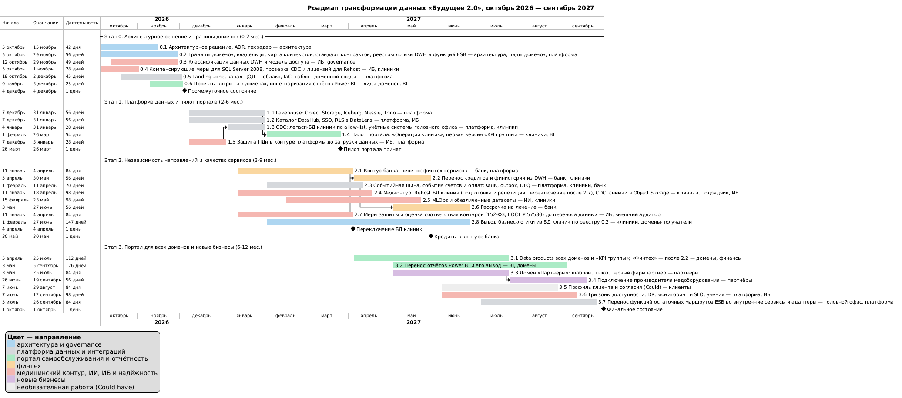

# Роадмап изменений технологического ландшафта

Горизонт — 12 месяцев, с октября 2026 по сентябрь 2027. Роадмап привязан к двум контрольным точкам бизнеса:

| Контрольная точка | Дата | Цель бизнеса | Этап роадмапа |
|---|---|---|---|
| **Промежуточное состояние** | 4 декабря 2026 (2 месяца) | Архитектурное решение сформировано и согласовано. Границы доменов определены, ключевые связи описаны. В доменах запланированы проекты витрины данных | Этап 0 |
| **Финальное состояние** | 1 октября 2027 (12 месяцев) | Портал самообслуживания реализован. Бизнес-пользователи в доменах работают с данными в новой архитектуре. Легаси временно сохраняется в отдельных доменах | Этапы 1–3 |

Исходник диаграммы — [roadmap.puml](roadmap.puml). Этапы частично идут параллельно: работы разных команд не зависят друг от друга, кроме отмеченных стрелками зависимостей.

## Направления роадмапа

Работы сгруппированы в три направления.

| Направление | Работы роадмапа |
|---|---|
| **Запуск портала самообслуживания** | 0.3 классификация данных и модель доступа, 0.6 проекты витрины в доменах, 1.1–1.4 платформа данных и пилот портала, 3.1 data products всех доменов, 3.2 перенос отчётов и вывод Power BI |
| **Независимое развитие подразделений** | 0.2 границы доменов, карта контекстов, стандарт контрактов и реестр функций ESB, 0.5 шаблон доменной среды, 2.1–2.2 контур банка и перенос банковских данных, 2.3 событийная шина, 2.5 MLOps, 2.6 рассрочка на лечение, 2.8 вывод бизнес-логики из БД клиник, 3.3–3.4 домен «Партнёры», 3.5 профиль клиента, 3.7 перенос функций остаточных маршрутов ESB |
| **Качество медицинских и финансовых сервисов** | 0.3 классификация медицинских данных, 0.4 компенсирующие меры для SQL Server 2008, 1.5 защита ПДн в контуре платформы, 2.1 изолированный контур банка с отказоустойчивыми БД, 2.2 перенос кредитов со сверкой, 2.4 медицинский контур и вынос снимков из СУБД с планом отката, 2.5 обучение ИИ только на обезличенных данных, 2.7 оценка соответствия контуров, 3.6 три зоны доступности, DR, мониторинг и SLO |

## Этапы

### Этап 0. Архитектурное решение и границы доменов — октябрь–ноябрь 2026

**Цель бизнеса:** промежуточное состояние через 2 месяца.

| Работа | Ответственные команды |
|---|---|
| 0.1 Архитектурное решение, ADR на ключевые решения, технический радар | Архитектура и governance |
| 0.2 Границы доменов и владельцы; карта контекстов с ключевыми связями между доменами; стандарт контрактов событий и data products; контракт на обезличенные датасеты для ИИ; реестр бизнес-логики DWH с доменом-получателем для каждой процедуры; реестр маршрутов ESB: ФЛК, пакетные и потоковые трансформации, маршрутизация, обработка ошибок и паттерны надёжности, интеграционная и бизнес-логика, владелец, целевой компонент и критерии переключения | Архитектура, лиды доменов, платформенная команда |
| 0.3 Классификация таблиц DWH (медицинские, банковские, прочие) и модель доступа по уровням | ИБ, governance |
| 0.4 Компенсирующие меры для SQL Server 2008: сетевая изоляция, проверка восстановления из бэкапа. Проверка редакции СУБД и возможности CDC, наличия образа Windows Server и лицензий SQL Server 2008 для Rehost. Договор с подрядчиком на сопровождение АРМ | ИБ, команда клиник |
| 0.5 Landing zone в Yandex Cloud: облака медконтура, банка и платформы, сети, IAM, ключи KMS, IaC-шаблон доменной среды. Канал связи собственного ЦОД с облаком (Cloud Interconnect, на время его подключения — site-to-site VPN): по нему до переезда БД клиник идут CDC и перенос данных | Платформенная команда |
| 0.6 Проекты витрины в доменах: бэклог data products с владельцами и сроками. Инвентаризация отчётов Power BI и список отчётов к выводу | Лиды доменов, BI головного офиса |

**Ожидаемые результаты:**

- **Архитектура и домены:**
  - архитектурное решение согласовано с руководством и ИБ;
  - шесть доменов с утверждёнными владельцами;
  - ключевые связи между доменами описаны в карте контекстов;
  - стандарт контрактов утверждён;
  - для каждой процедуры бизнес-логики DWH известен домен-получатель;
  - для каждого маршрута ESB зафиксированы функции, владелец, целевой компонент и критерии переключения и отката.
- **Данные и доступ:**
  - 100 % таблиц DWH классифицированы;
  - ролевая модель доступа утверждена.
- **Инфраструктура и легаси:**
  - облачные контуры развёрнуты из Terraform;
  - канал ЦОД — облако работает;
  - SQL Server 2008 изолирован, восстановление из бэкапа проверено;
  - выбран способ CDC.
- **Витрина:**
  - в каждом домене есть план проектов витрины;
  - определено, какие отчёты Power BI переносятся, а какие выводятся.

**Ресурсы:**

- около 28 человеко-месяцев (около 14 FTE в течение двух месяцев, включая подрядчика PowerBuilder);
- облако — 0,2–0,4 млн ₽ в месяц (landing zone и тестовые среды).

### Этап 1. Платформа данных и пилот портала — декабрь 2026 — март 2027

**Цель бизнеса:** первые пользователи работают с данными в новой архитектуре. Скорость отчётности доказана на реальных данных.

| Работа | Ответственные команды |
|---|---|
| 1.1 Lakehouse: Object Storage, Apache Iceberg, Nessie, Managed Trino | Платформенная команда |
| 1.2 Каталог DataHub, SSO через Identity Hub, RLS в DataLens | Платформенная команда, ИБ |
| 1.3 CDC немедицинских таблиц легаси-БД клиник по allow-list и учётных систем головного офиса | Платформенная команда, команда клиник |
| 1.4 Пилот портала на data products «Операции клиник» и первой версии «KPI группы» | Команда клиник, BI и финансы головного офиса |
| 1.5 Защита ПДн в контуре платформы до загрузки первых данных (выполняется до 1.3): модель угроз и уровень защищённости ИСПДн, меры по 152-ФЗ, псевдонимизация ID пациента при репликации (трансформация в Data Transfer), журнал доступа к данным. Платформа получает только немедицинские ПДн, поэтому требования ниже, чем к медконтуру, но выполняются до появления в ней данных | ИБ, платформенная команда |

Для пилота выбраны клиники и головной офис: их данные доступны через CDC уже на этом этапе. Банковские данные публикуются в data product «Финтех» после переноса кредитов в контур банка (работы 2.2 и 3.1), чтобы банковская тайна не покидала контур банка.

**Ожидаемые результаты:**

- платформа данных работает в продуктиве;
- два data products опубликованы и зарегистрированы в каталоге;
- 20–30 пилотных пользователей строят отчёты сами;
- дашборды KPI пилотных доменов открываются за секунды, сложные отчёты строятся за минуты вместо часов;
- автоматическая проверка контрактов подтверждает: медицинских полей в платформе нет;
- меры защиты ПДн в контуре платформы приняты ИБ до загрузки данных, ID пациентов в Lakehouse только псевдонимизированные;
- по итогам пилота на радаре переходят из Trial в Adopt: Data Lakehouse, Apache Iceberg, Managed Trino, Yandex DataLens, Yandex Data Transfer, Apache Spark, Yandex Data Processing, Managed Airflow, Yandex Identity Hub.

**Ресурсы:**

- около 34 человеко-месяцев (около 8,5 FTE в течение четырёх месяцев);
- облако — от 0,4 до 1,5 млн ₽ в месяц, растёт с объёмом загруженных данных.

### Этап 2. Независимость направлений и качество сервисов — январь–июнь 2027

**Цель бизнеса:** финтех и ИИ развиваются без зависимости от DWH. Медицинские и банковские данные изолированы.

| Работа | Ответственные команды |
|---|---|
| 2.1 Контур банка: перенос финтех-сервисов в Managed Kubernetes, банковские БД — Managed PostgreSQL в трёх зонах доступности | Команда банка, платформенная команда |
| 2.2 Перенос кредитов и финансовой истории из DWH: параллельная работа и ежедневная сверка | Команда банка, команда клиник |
| 2.3 Событийная шина Kafka со Schema Registry, события «счёт выставлен» и «счёт оплачен»: перенос ФЛК и преобразований в адаптер клиник и сервисы банка, transactional outbox, дедупликация, retry и DLQ в соответствующих контурах. Проверка повторной доставки и восстановления до переключения маршрутов | Платформенная команда, команды клиник и банка |
| 2.4 Медицинский контур: Rehost БД клиник с планом переключения и отката, переключение CDC (Data Transfer, Debezium) на перенесённую БД, вынос снимков в Object Storage, адаптер событий, доработка АРМ. Подготовка целевой ВМ и репетиции переезда идут параллельно с оценкой 2.7, само переключение — после её завершения (веха «Переключение БД клиник») | Команда клиник, подрядчик по миграции, ИБ |
| 2.5 MLOps и обезличенные датасеты по контракту с клиниками | Команда ИИ, команда клиник |
| 2.6 Новый продукт «рассрочка на лечение» на событиях клиник | Команда банка |
| 2.7 Меры защиты и оценка соответствия контуров до переноса в них данных: защита ПДн по 152-ФЗ для медицинского контура, ГОСТ Р 57580 и требования Банка России для контура банка. Перенос кредитов (2.2) и переключение БД клиник (2.4) начинаются только после оценки | ИБ, внешняя организация с лицензией ФСТЭК на техническую защиту конфиденциальной информации |
| 2.8 Вывод бизнес-логики из БД клиник по реестру 0.2. Процедура отключается после того, как её потребители переключены на замену: логика финтеха — на сервисы банка (2.1–2.2), логика ИИ — на MLOps и API анализа (2.5), отчётные расчёты — на data products (1.4, 3.1). Метрика — доля процедур реестра, отключённых в БД клиник: финтех и ИИ — 100 % к концу этапа 2, отчётность — вместе с выводом Power BI (3.2) | Команда клиник (DBA MS SQL), команды банка и ИИ, BI головного офиса |

**Ожидаемые результаты:**

- **Финтех:**
  - банк работает в собственном контуре;
  - кредиты и финансовая история больше не хранятся в DWH, расхождений по сверке нет;
  - рассрочка на лечение запущена без доработки DWH и клинических систем;
  - события счетов проходят ФЛК, outbox обеспечивает публикацию после фиксации операции, повторная доставка не создаёт повторную оплату; восстановление из DLQ проверено.
- **Клиники и ИИ:**
  - бизнес-логика финтеха и ИИ удалена из БД клиник: 100 % процедур финтеха и ИИ из реестра 0.2 отключены (работа 2.8);
  - снимки хранятся в объектном хранилище;
  - переезд БД клиник прошёл без остановки приёма пациентов;
  - ИИ выпускает новые версии моделей через MLOps, обучение идёт только на обезличенных данных.
- **Соответствие требованиям:** оценка соответствия медицинского контура и контура банка завершена до переноса в них данных.
- **Радар:** из Trial в Adopt переходят Managed Kafka, событийная интеграция, Debezium, MLOps, MLflow, Yandex DataSphere, обезличивание и псевдонимизация.

**Ресурсы:**

- около 100 человеко-месяцев (около 17 FTE в течение шести месяцев, включая двух инженеров подрядчика на миграцию БД клиник). Работа 2.8 входит в эту оценку: процедуры отключает DBA команды клиник, замену готовят команды-получатели в рамках работ 2.1–2.2 и 2.5;
- внешняя оценка соответствия по ГОСТ Р 57580 и 152-ФЗ — отдельный договор с лицензированной организацией;
- облако — 1,5–3,5 млн ₽ в месяц (контуры банка и медицины, Kafka, GPU для ИИ).

### Этап 3. Портал для всех доменов и новые бизнесы — апрель–сентябрь 2027

**Цель бизнеса:** финальное состояние. Портал реализован, домены работают в новой архитектуре, новые бизнесы подключаются без DWH.

| Работа | Ответственные команды |
|---|---|
| 3.1 Data products всех доменов и сводный data product «KPI группы». «Финтех» публикуется после переноса кредитов в контур банка (веха «Кредиты в контуре банка» в конце работы 2.2), до этого «KPI группы» собирается без банковских показателей | Доменные команды, финансы головного офиса |
| 3.2 Перенос используемых отчётов Power BI в портал, вывод Power BI | BI головного офиса, доменные команды |
| 3.3 Домен «Партнёры»: шаблон, шлюз, первый фармпартнёр | Команда партнёрских интеграций |
| 3.4 Подключение производителя медоборудования | Команда партнёрских интеграций |
| 3.5 Профиль клиента и согласия (Could have: выполняется при наличии ресурсов) | Команда домена «Клиенты» |
| 3.6 Размещение критичных систем в трёх зонах доступности (разные ЦОД региона), план DR, мониторинг и SLO записи пациентов и платежей, учения по восстановлению | Платформенная команда, ИБ |
| 3.7 Перенос функций остаточных маршрутов ESB во внутренние сервисы и адаптеры по реестру 0.2: ФЛК, пакетные и потоковые трансформации, маршрутизация, надёжность, интеграционная и бизнес-логика | Головной офис, платформенная команда |

Маршруты переключаются по [порядку перехода от ESB](../Task1/README.md#порядок-переключения-маршрутов): теневое сравнение без повторных операций, сверка результатов, один активный путь записи, проверенный откат и обработка остатка очередей. Правила принимает домен-получатель, платформенная команда сопровождает среду исполнения.

**Ожидаемые результаты:**

- **Портал и отчётность:**
  - портал доступен бизнес-пользователям всех доменов;
  - KPI группы считаются из data products;
  - Power BI выключен, отчётные процедуры реестра 0.2 отключены в БД клиник — в ней остаётся только операционная логика клиник.
- **Новые бизнесы:**
  - фармпартнёр и производитель оборудования подключены;
  - следующий партнёр подключается за 4–6 недель.
- **Надёжность:**
  - критичные системы работают в трёх зонах доступности;
  - восстановление проверено учениями;
  - для записи пациентов и платежей действуют SLO.
- **Легаси:**
  - ESB сохраняет только остаточные внутренние маршруты со всеми ФЛК, трансформациями, маршрутизацией, механизмами надёжности, интеграционной и бизнес-логикой до приёмки замены; у каждого маршрута есть владелец и срок вывода;
  - легаси (БД клиник и АРМ) сохраняется только в домене «Клиники».
- **Радар:** в Adopt переходят Data Mesh, data products и контракты, DataHub, Yandex API Gateway, SLO для критичных сервисов.

**Ресурсы:**

- около 118 человеко-месяцев (около 19,5 FTE в течение шести месяцев);
- облако — 3,5–5,0 млн ₽ в месяц (полный объём данных, все домены, резервные зоны).

## Команды и загрузка

Загрузка — доля времени команды, выделенная на работы роадмапа. Остальное время команды занимаются текущей поддержкой и продуктовыми задачами. Этапы пересекаются по времени, поэтому общая трудоёмкость считается по кварталам.

| Команда | Состав | IV кв. 2026 | I кв. 2027 | II кв. 2027 | III кв. 2027 |
|---|---|---|---|---|---|
| Архитектура и governance | 3: архитектор, лид data governance, бизнес-аналитик | 100 % | 60 % | 40 % | 40 % |
| ИБ | 2 | 80 % | 70 % | 60 % | 60 % |
| Платформенная команда данных | 7: владелец продукта, 2 инженера платформы, 2 DevOps/SRE, 2 data-инженера | 60 % | 100 % | 100 % | 80 % |
| Команда клиник | 5: лид, 2 Java-разработчика, DBA MS SQL, data-инженер | 30 % | 70 % | 70 % | 40 % |
| Команда ИИ | 4: лид, 2 ML-инженера, MLOps-инженер | 10 % | 40 % | 70 % | 30 % |
| Команда банка | 6: лид, 3 разработчика Go/Java, DevOps, data-инженер | 20 % | 80 % | 90 % | 40 % |
| BI и финансы головного офиса | 4: лид BI, 2 BI-аналитика, финансовый аналитик | 30 % | 50 % | 80 % | 100 % |
| Команда партнёрских интеграций | 3: формируется из разработчиков интеграций ESB | — | — | 60 % | 100 % |
| Команда домена «Клиенты» | 3, резерв под работу 3.5 (Could have) | — | — | 20 % | 100 % |
| Подрядчики | Сопровождение PowerBuilder (1); миграция БД клиник (2, в I–II кв.); внешняя оценка соответствия (по договору, не входит в человеко-месяцы) | 1 чел. | 3 чел. | 3 чел. | 1 чел. |
| **Итого, человеко-месяцев** | 37 сотрудников + до 3 подрядчиков | ≈ 42 | ≈ 75 | ≈ 89 | ≈ 74 |

За год это около 280 человеко-месяцев: этап 0 — 28, этап 1 — 34, этап 2 — 100, этап 3 — 118. Пиковая нагрузка приходится на команды клиник и платформы в I–II кварталах. Поэтому миграцию БД клиник ведёт подрядчик, а обезличивание (2.5) стартует после того, как команда клиник освобождается от работы 1.3.

## Бюджет облака

| Период | Облако, млн ₽ в месяц | Из чего складывается |
|---|---|---|
| IV кв. 2026 | 0,2–0,4 | Landing zone, канал связи с ЦОД, тестовые среды |
| I кв. 2027 | 0,4–1,5 | Lakehouse с пилотными данными, Trino, DataHub, CDC |
| II кв. 2027 | 1,5–3,5 | Контуры банка и медицины, Kafka, GPU для ИИ, рост объёма Lakehouse |
| III кв. 2027 | 3,5–5,0 | Сотни терабайт в Object Storage, все домены, резервные зоны |

Это оценка для бюджетирования, она уточняется по итогам пилота на этапе 1. Чтобы сдерживать стоимость:

- редко используемые данные переводятся в холодный класс хранения;
- для пайплайнов используются автомасштабирование и прерываемые узлы;
- квоты выделяются по доменам.

Встречная экономия возникает после вывода систем:

- поддержка оборудования собственного ЦОД;
- лицензии и сопровождение SQL Server и Power BI;
- трудозатраты центральной команды DWH на доработки под направления.

Её размер рассчитывается по результатам инвентаризации на этапе 0.

## Обоснование этапов для бизнеса

| Этап | Скорость принятия решений | Качество сервиса | Снижение затрат | Масштабирование | Тип обоснования |
|---|---|---|---|---|---|
| 0. Архитектурное решение и границы доменов | У каждого домена есть владелец, который решает сам, без очереди в центральную команду | Сразу снижается риск инцидента с неподдерживаемой СУБД, где лежат медданные | Минимальные затраты: проектирование и landing zone за 0,2–0,4 млн ₽ в месяц. Ошибка в границах доменов обошлась бы дороже, чем два месяца проектирования | Шаблон доменной среды готовит подключение новых направлений | Минимизация ущерба, инвестиция |
| 1. Платформа данных и пилот портала | Отчёты пилотных доменов строятся за минуты вместо часов, руководство получает данные к моменту решения | Аналитическая нагрузка снята с БД, с которой работают операторы клиник | Оплата облака по факту вместо закупки оборудования под сотни терабайт | Платформа масштабируется горизонтально, новый домен добавляет data products без доработки хранилища | Инвестиция |
| 2. Независимость направлений | Финтех и ИИ выпускают продукты в своём ритме: рассрочка на лечение и новые модели — без очереди в DWH | Изоляция медицинских и банковских данных, отказоустойчивые банковские БД, подтверждённое соответствие контуров требованиям, обучение ИИ только на обезличенных данных | Выводится часть on-prem оборудования, снижается нагрузка на центральную команду | Независимые релизы и инфраструктура каждого направления | Инвестиция, минимизация ущерба |
| 3. Портал для всех доменов и новые бизнесы | Самообслуживание для всех сотрудников в пределах уровня доступа, единые KPI группы | Три зоны доступности, проверенный DR и SLO для записи пациентов и платежей | Вывод Power BI и большей части собственного ЦОД, ESB сохраняет полный набор функций остаточных внутренних маршрутов до приёмки их замены | Фарма и производитель оборудования подключаются по шаблону за недели, а не за месяцы доработки DWH | Экономия, инвестиция в рост выручки |

## Оценка систем по модели TIME

| Система | Техническая пригодность | Функциональная пригодность | TIME | Стратегия миграции (6R) | Работы роадмапа |
|---|---|---|---|---|---|
| DWH на MS SQL Server 2008 | Низкая: снят с поддержки, не масштабируется | Высокая: на нём держится работа клиник | Migrate | Rehost в медконтур, Retire бизнес-логики и аналитики, замена СУБД — после года | 0.4, 1.3, 2.2, 2.4 |
| Power BI | Средняя: риски лицензирования и доступности | Низкая: нет самообслуживания, отчёты делает центральная команда | Eliminate | Repurchase: портал на DataLens | 3.2 |
| АРМ на PowerBuilder | Низкая: устаревший стек | Высокая: рабочее место операторов | Migrate (после года) | Retain на переходный период с минимальной доработкой | 2.4 |
| ESB на Apache Camel | Низкая: единая точка отказа | Высокая для действующих маршрутов: проверки, трансформации и логика обеспечивают операции | Migrate | Refactor функций в доменные сервисы, адаптеры и аналитические пайплайны; Retain остаточных внутренних маршрутов со всеми правилами; Retire после приёмки замены | 0.2, 2.3–2.5, 3.7 |
| ИИ-сервисы на Python | Высокая | Высокая | Invest | Replatform на Managed Kubernetes и MLOps | 2.5 |
| Финтех-сервисы на Go и Java | Высокая | Высокая | Invest | Rehost и Replatform в контур банка | 2.1, 2.6 |
| Внутренние сервисы головного офиса | Высокая: поддерживаемые учётные системы | Высокая | Invest | Retain систем; функции маршрутов ESB переходят во внутренние сервисы и их адаптеры | 3.7 |

## Риски роадмапа

| Риск | Влияние | Мера |
|---|---|---|
| В компании нет опыта Lakehouse и Data Mesh | Срыв сроков этапов 1 и 3 | Managed-сервисы вместо self-hosted, пилот на двух доменах, обучение команд до тиражирования |
| Доменные команды не готовы владеть данными | Data products не публикуются, нагрузка возвращается к центральной команде | Владельцы утверждаются на этапе 0, платформа даёт шаблоны пайплайнов, у группы governance есть ресурс на сопровождение доменов |
| Перегрузка команд клиник и платформы в I–II кварталах | Сдвиг работ 2.3–2.5 и пилота портала | Подрядчик на миграцию БД клиник, последовательный старт работ команды клиник, еженедельный контроль загрузки |
| CDC из SQL Server 2008: нативный CDC есть только в Enterprise-редакции, Debezium официально поддерживает более новые версии | Нет потока изменений для Lakehouse и событий счетов | Проверка на этапе 0 (работа 0.4). Запасные варианты — Change Tracking, инкрементальная выгрузка по метке времени, outbox-таблица с триггером |
| Простой клиник при переезде БД | Остановка приёма пациентов | Репетиция переезда, переключение в нерабочее время, план отката на исходный сервер. Rehost требует образа Windows Server под SQL Server 2008 и собственных лицензий, их наличие проверяется на этапе 0 |
| Ошибки при переносе банковских данных из DWH | Расхождения в кредитах и платежах | Параллельная работа старого и нового контуров, ежедневная сверка, переключение только после нулевых расхождений |
| Managed Trino не поддерживает каталог Nessie для Iceberg-таблиц или работает с ним нестабильно | Платформа данных не запускается в срок, пилот портала сдвигается | Проверка совместимости в первые две недели работы 1.1 на тестовых таблицах. Запасной вариант — каталог Iceberg в Yandex MetaData Hub (Hive Metastore) или JDBC-каталог: ветки загрузки Nessie тогда заменяются загрузкой в staging-таблицы с проверкой перед публикацией |
| Утечка медицинских данных в аналитику | Нарушение 152-ФЗ и врачебной тайны | Allow-list в CDC, проверка контрактов при регистрации data products, отдельные облака медконтура, шифрование KMS, аудит доступа |
| Рост стоимости облака | Превышение бюджета | Квоты по доменам, холодное хранение, ежемесячный разбор затрат |
