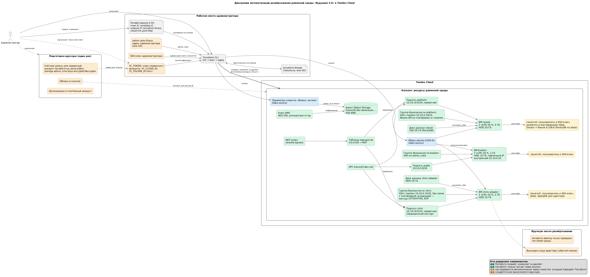
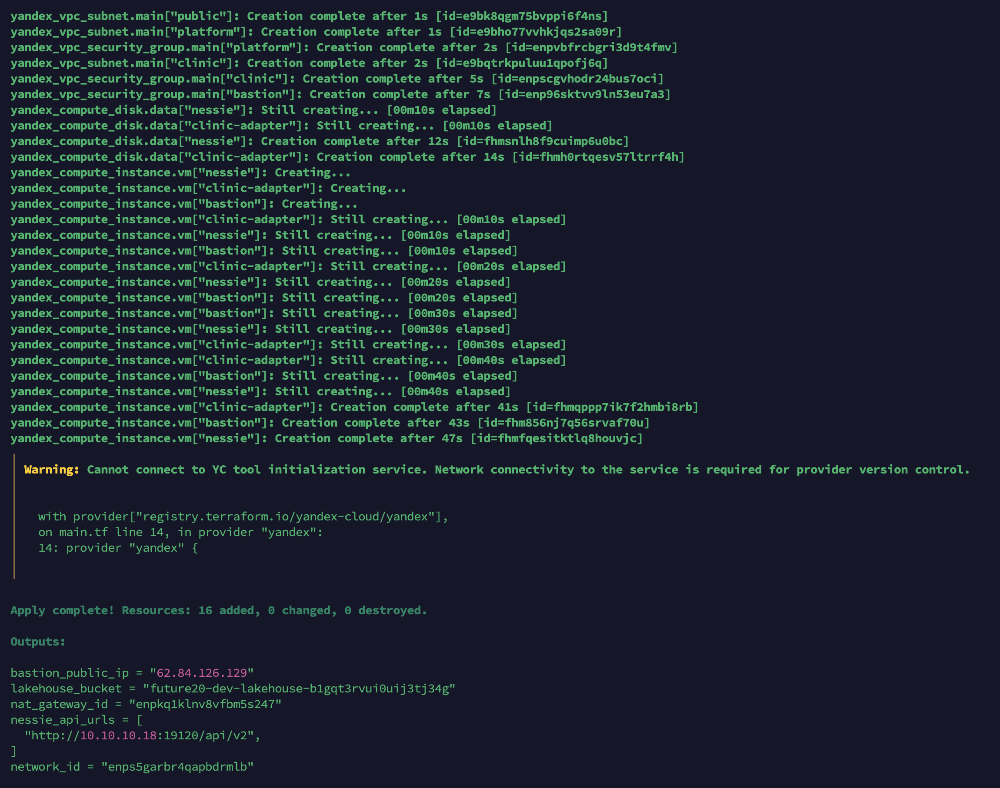

# Облачная инфраструктура доменной среды в Yandex Cloud

| Файл | Содержание |
|---|---|
| [main.tf](main.tf) | Описание инфраструктуры: сеть, подсети, NAT-шлюз, таблица маршрутов, группы безопасности, ВМ, диски, ключ KMS, бакет |
| [variables.tf](variables.tf) | Определение переменных |
| [outputs.tf](outputs.tf) | Вывод ключевых параметров: ID сети и подсетей, IP-адреса ВМ, команды SSH, адрес Nessie, имя бакета |
| [terraform.tfvars](terraform.tfvars) | Значения переменных (только несекретные) |
| [cloud-init.yaml.tftpl](cloud-init.yaml.tftpl) | Шаблон начальной настройки ВМ: пользователь, SSH-ключ, диск данных, ПО по роли |
| [diagram.puml](diagram.puml), [diagram.png](diagram.png) | Диаграмма автоматизации развёртывания: что делает Terraform, а что выполняется вручную |
| [justification.md](justification.md) | Обоснование ресурсов, размеров ВМ и дисков, NAT, декларативного подхода и IaC |
| [terraform_apply.png](terraform_apply.png) | Результат `terraform apply` |



## Запуск

Секреты и идентификаторы облака передаются через переменные окружения:

```bash
export YC_TOKEN=$(yc iam create-token)          # или YC_SERVICE_ACCOUNT_KEY_FILE=<путь к ключу сервисного аккаунта>
export YC_CLOUD_ID=<ID облака>
export YC_FOLDER_ID=<ID каталога>

# Адрес, с которого разрешён SSH на bastion. Файл исключён из Git и переопределяет заглушку из terraform.tfvars
echo "admin_cidrs = [\"$(curl -s https://ifconfig.me)/32\"]" > admin.auto.tfvars

terraform init
terraform plan
terraform apply
```

После проверки тестовая среда удаляется командой `terraform destroy`.

Требования к облаку:

- роли `editor`, `storage.admin` и `kms.keys.encrypterDecrypter` на каталог у учётной записи или сервисного аккаунта, от имени которого запускается Terraform (последняя нужна, чтобы включить шифрование бакета ключом KMS);
- квоты: одна дополнительная облачная сеть, один NAT-шлюз, один публичный IP-адрес, три ВМ.

## Результат terraform apply



Предупреждение провайдера «Cannot connect to YC tool initialization service» означает, что провайдер не смог проверить наличие своей новой версии. На развёртывание оно не влияет.
